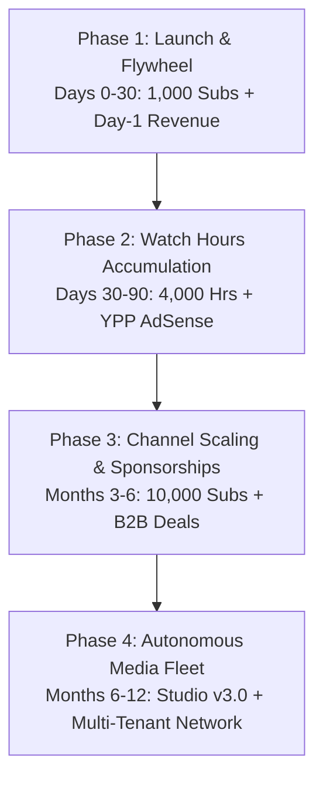

# Master Roadmap: Antigravity Creator Studio & YouTube Monetization Fleet

## Executive Vision
Transform the **Antigravity Creator Studio** from an enterprise-grade automated production environment into a self-sustaining, high-RPM developer media network that compounds subscribers, watch hours, and multi-channel software revenue.



---

## 1. Current State Baseline: Enterprise v2.6 Certified

The repository is fully equipped with an operational Ubuntu-based creator operating system:

| Core Pillar | Operational Artifact | Certified Capability |
| :--- | :--- | :--- |
| **Pillar 1: Persistence** | [`studio.db`](file:///home/rockyy/oct%20catalog/youtube%20channel/studio.db) (SQLite WAL) | Transactional state store for `runs`, `qa_audits`, `publications`, `dead_letter_queue`. |
| **Pillar 2: Resilience & Services** | [`services/`](file:///home/rockyy/oct%20catalog/youtube%20channel/services/) | Modular domain services: `db_service`, `resilience` (retries), `media_service` (EBU R128), `analytics_service`, `compliance_service`. |
| **Pillar 3: Agent Protocol (MCP)** | [`mcp_server.py`](file:///home/rockyy/oct%20catalog/youtube%20channel/mcp_server.py) | FastMCP + JSON-RPC 2.0 gateway exposing video audits, loudness auto-fixing, and outlier intelligence to external AI agents. |
| **Pillar 4: System Supervision** | [`scripts/setup-systemd.sh`](file:///home/rockyy/oct%20catalog/youtube%20channel/scripts/setup-systemd.sh) | User-level systemd service (`antigravity-studio.service`) and daily 06:00 AM timer (`antigravity-niche-sync.timer`). |
| **Pillar 5: Intelligence Radar** | [`scripts/swipe.py`](file:///home/rockyy/oct%20catalog/youtube%20channel/scripts/swipe.py) (`yt-viral`) | Outlier scraper with 21 viral title formulas and median multiples ($\ge 2.0\times$). |
| **Pillar 6: Headless Rendering** | [`services/stitch_service.py`](file:///home/rockyy/oct%20catalog/youtube%20channel/services/stitch_service.py) | Programmatic FFmpeg video assembly generating 1080p60 landscape & 9:16 vertical shorts mastered to -14.0 LUFS. |
| **Pillar 7: Control Center UI** | [`studio_server.py`](file:///home/rockyy/oct%20catalog/youtube%20channel/studio_server.py) | Vanilla CSS 3-column dashboard running on `http://localhost:8000` with zero external CDN dependencies. |

---

## 2. Phase-by-Phase Growth & Monetization Milestones

### Phase 1: Launch & Flywheel (Days 0 – 30)
* **Core Goal:** Reach **1,000 Subscribers** and establish Day-1 non-AdSense revenue.
* **Content Cadence:**
  * **2 Long-Form Videos/week:** 8:00–12:00 runtime (Videos #1 through #6 ready to roll).
  * **3 Shorts/week:** 45–58s vertical videos with infinite loop hooks to accelerate subscriber acquisition.
* **The Shorts Flywheel:** Shorts convert viewers at a $4\times$ to $8\times$ higher subscriber rate than long-form. Every long-form deep dive has a companion Short staged in `video_XX_shorts_script.md`.
* **Day-1 Monetization Channels:**
  * **Digital Starter Code:** Gumroad starter packs (`https://gumroad.com/l/antigravity-starter`) linked in pinned comments and descriptions.
  * **GitHub Sponsors:** Developer support tier for access to production `.agents/skills/` templates.
  * **High-RPM Developer Affiliates:** Cloud hosting (Hetzner, Cloudflare), AI inference (Groq, Together AI), and hardware (Shure MV7+) with mandatory FTC disclosures.
* **Target Revenue:** **$500 – $1,500 / month** (Immediate cashflow before AdSense approval).

---

### Phase 2: Public Watch Hours & YPP AdSense Activation (Days 30 – 90)
* **Core Goal:** Accumulate **4,000 Public Watch Hours** and unlock YouTube Partner Program (YPP) AdSense monetization.
* **The 60/40 Synergy Formula:**
  $$\text{Watch Hours Engine} = 60\% \text{ Evergreen Search (Compounding)} + 40\% \text{ Browse Breakouts (Spikes)}$$
  * **60% Evergreen Search:** High-intent developer topics (*"Build Lead Triage Agent with FastAPI"*, *"PostgreSQL Deadlock Guard"*) that passively generate 50–150 watch hours every single week for years.
  * **40% Browse Breakouts:** High-stakes constraint videos (*"Hardcore DevOps: Delete My Server If This Agent Fails"*, *"Antigravity vs Cursor: The Real Benchmark"*) targeting YouTube homepage recommendations.
* **Mid-Roll Ad Placement Optimization:**
  * Every long-form video is calibrated at **$\ge$ 8:30 runtime**. Videos exceeding 8 minutes enable manual and automatic mid-roll ad placement, doubling or tripling effective RPM.
* **Niche RPM Advantage:**
  * Software engineering, AI orchestration, and cloud infrastructure command **$22.00 – $38.50+ RPM** compared to entertainment ($2.00 – $4.00 RPM).
  * **100,000 monthly views in this niche = $2,200 – $3,850 in AdSense alone.**
* **Target Revenue:** **$2,500 – $5,000 / month**.

---

### Phase 3: Channel Scaling & B2B Tool Sponsorships (Months 3 – 6)
* **Core Goal:** Reach **5,000 – 10,000 Subscribers** and initiate direct B2B sponsorships.
* **Sponsorship Monetization:**
  * B2B developer tool companies (DevOps platforms, vector databases, observability stacks, AI model providers) pay flat integration fees of **$500 – $2,500+ per video** for channels with engaged developer audiences, regardless of view count.
* **Automated Lead Gen Pipeline:**
  * Auto-generate a standalone GitHub repository for every video take.
  * Tag releases with [`scripts/repurpose-engine.sh`](file:///home/rockyy/oct%20catalog/youtube%20channel/scripts/repurpose-engine.sh).
  * Use open-source code as an inbound traffic magnet.
* **Community Flywheel:**
  * Private Discord / GitHub Sponsors Pro tier for engineers deploying agent swarms in production.
* **Target Revenue:** **$6,000 – $12,000 / month**.

---

### Phase 4: Autonomous Media Fleet & Multi-Tenant Scaling (Months 6 – 12)
* **Core Goal:** **50,000+ Subscribers** and an autonomous multi-platform technical publication.
* **Paid Newsletter Syndication:**
  * Repurpose video scripts into technical deep-dive issues on Substack / Beehiiv via [`services/dispatch_service.py`](file:///home/rockyy/oct%20catalog/youtube%20channel/services/dispatch_service.py).
  * Convert 2–5% of YouTube subscribers into $10/mo paid newsletter readers.
* **Course & Enterprise Training Tier:**
  * Bundle Season 1 & Season 2 skill packs into a comprehensive *"Production Agentic Engineering Masterclass"*.
* **Target Revenue:** **$20,000 – $35,000+ / month**.

---

## 3. Future Architectural Suggestions (Studio v3.0 Blueprint)

To evolve the technical studio from headless FFmpeg scripts into a bleeding-edge autonomous AI video studio, here are the top 5 high-leverage architectural upgrades:

### 1. Remotion React-Based Programmatic Motion Graphics
* **Problem:** Raw FFmpeg concatenations are fast, but static terminal recordings lack the visual polish and kinetic dynamism of top-tier YouTube channels.
* **Upgrade:** Integrate **Remotion** (React-based video framework):
  * Render beautiful animated terminal windows with custom themes (Tokyo Night, Catppuccin).
  * Programmatic syntax-highlighted code diffs (lines sliding in with green/red highlighting).
  * Smooth auto-zoom, dynamic panning, and spring animations on code punch-ins without touching an NLE.
  * Render headless MP4s using Remotion CLI inside Docker.

### 2. Closed-Loop YouTube Analytics Feedback Agent
* **Problem:** Title and thumbnail optimization currently relies on manual intuition post-publish.
* **Upgrade:** Autonomous Closed-Loop Performance Agent:
  * Ingest the **YouTube Analytics API v3** on an hourly background cron.
  * Track 2-hour, 6-hour, and 24-hour **Click-Through Rate (CTR)** and **30-Second Audience Retention**.
  * **Automatic Title A/B Swapper:** If initial CTR is below 6.5% after 4 hours, the agent automatically swaps Title Variant A for Title Variant B via YouTube Data API.
  * **Retention Anomaly Detector:** Flags exact timestamps where audience drop-offs occur and feeds the data into the scriptwriting agent's prompt to avoid that pattern in future episodes.

### 3. Multimodal Voice Synthesis & Automatic Caption Burning
* **Problem:** Recording voiceover takes manually creates a production bottleneck.
* **Upgrade:** Integrate **ElevenLabs API** / **Gemini 3.8 Live API**:
  * Clone the creator's voice model with calibrated SSML cadence and emotional inflection tags (`<break time="250ms"/>`).
  * Use **Whisper** to generate word-level timestamps (`.srt` / `.ass`).
  * Auto-burn styled, colored, kinetic captions onto vertical Shorts (similar to Opus Clip or Submagic, but fully self-hosted and zero-cost).

### 4. Distributed Celery + Redis Asynchronous Task Queue
* **Problem:** Current background jobs run inside FastAPI's async threadpool on a single machine.
* **Upgrade:** Decouple into a distributed cluster:
  * Use **Celery + Redis** to distribute video rendering, audio loudness mastering, and AI transcription across multiple GPU worker nodes (RunPod, Modal, or local workstation).
  * Persistent job tracking with exponential backoff and persistent worker queues.

### 5. Automated GitHub PR & Awesome-List Lead Generator
* **Problem:** Getting initial views on new videos requires manual community posting.
* **Upgrade:** Inbound Developer SEO Generator:
  * For every video, an agent automatically scaffolds a clean public GitHub starter repository with complete README and MIT license.
  * Automatically opens structured Pull Requests on curated `awesome-*` developer repositories (e.g., `awesome-ai-agents`, `awesome-fastapi`).
  * GitHub repository search ranks prominently on Google, driving high-intent developer views directly to the pinned YouTube tutorial link.

---

## 4. Operational Checklist & Action Matrix

```
[WEEKLY CREATOR CYCLE]
  Monday 06:00 AM  ──► Systemd timer syncs data/niche_collected.json
  Monday 09:00 AM  ──► Creator inspects http://localhost:8000/api/swipe
  Monday 11:00 AM  ──► Top outlier selected (SHIP IT gate)
  Tuesday          ──► Roll camera using Live Filming Run-Sheet (tmux 3-pane)
  Wednesday        ──► Drop takes into assets/ -> Run render-automated-video.py
  Thursday         ──► 1-Click dispatch to YouTube API, X v2, LinkedIn, Beehiiv
  Friday           ──► Review audience retention & Gumroad conversions
```

The system is architected, tested, and ready to scale.
